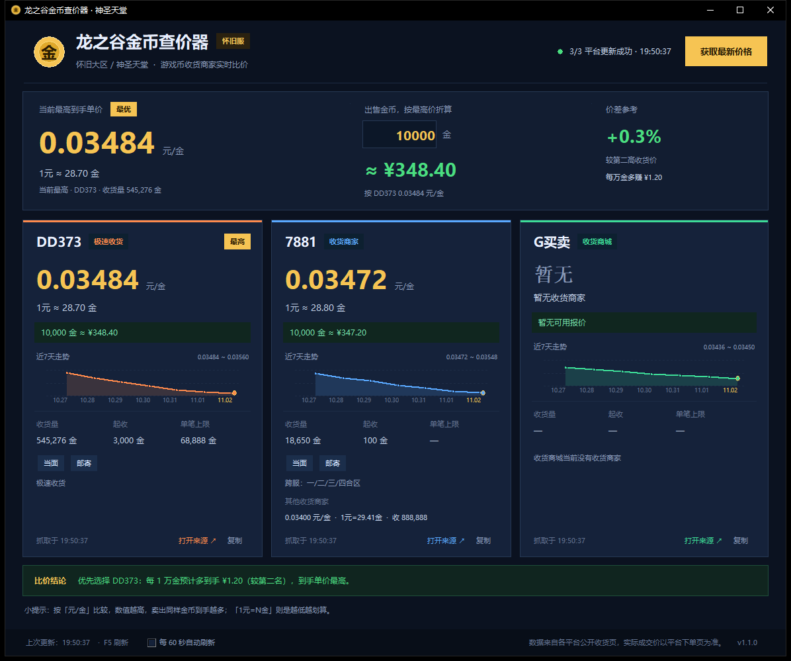

# 龙之谷金币查价器

一个给《龙之谷怀旧服》玩家用的比价工具：一键抓取 **DD373（怀旧服神圣天堂）、DD373（港澳台服 LIVE）、7881（怀旧服）、7881（港澳台服 LIVE）、G买卖** 五个平台当前「收货商家」的报价，按到手单价从高到低展示，并给出「卖到哪个平台更划算」的结论。

有两个形态：

- **Windows 桌面版**（Tkinter，当前主力版本）
- **Docker / 网页版**（跑在路由器或 NAS 的容器里，局域网浏览器访问，界面与桌面版一致）

当前固定区服：**怀旧大区 / 神圣天堂 / 游戏币**，以及 **港澳台服 / LIVE / 游戏币**。



> 上图为 7 天曲线效果示意（走势为演示数据）。实际运行时，三个平台官网都没有公开的收货价历史接口，曲线会从本机每次成功获取的价格开始积累，保留最近 7 天；首次运行只显示「今天 · 积累中」。

## 功能

- **一键获取**：点击「获取最新价格」或按 `F5`，并行抓取三家平台。
- **收货价对比**：同时显示「元/金」和「1元=N金」两种口径。
- **7 日走势图**：每个平台卡片内嵌一条近 7 天曲线，鼠标悬停可看具体日期、时间和价格。
- **自动算到手金额**：输入金币数量（默认 10,000），实时显示各平台预计到手人民币。
- **最高价提示**：自动标记最高到手单价，并计算比第二名每万金多赚多少。
- **多商家报价**：同一平台有多家收货商时，展开显示其他报价。
- **容错 / 上次数据**：平台抓取失败，或抓取成功但当前没有收货商家时，保留上一次成功报价并标记「上次数据」；不影响其他平台。
- **自动刷新**：可选每 60 秒刷新一次。
- **复制报价**：每张卡片可一键复制文字报价，方便发群里。

## 直接使用（Windows）

发布包有两个版本，任选其一：

### 便携版（推荐）

1. 解压 `龙之谷金币查价器-便携版-v1.1.zip`。
2. 进入文件夹，双击 `龙之谷金币查价器.exe`。
3. 点「获取最新价格」。

无需安装，文件夹可以放在任意位置；首次启动比单文件版快。

### 单文件版

1. 解压 `龙之谷金币查价器-单文件版-v1.1.zip`。
2. 优先双击 `启动查价器.bat`（最稳）；也可以直接双击 `龙之谷金币查价器.exe`，如果没反应再用 bat。
   - bat 会把临时目录设置到当前文件夹，避免少数电脑 `%TEMP%` 权限异常导致单文件版无法启动。
3. 点「获取最新价格」。

单文件版首次启动需要解压 3–8 秒，之后会快一些。

> 建议解压到较短路径（例如 `D:\龙之谷金币查价器`）。路径过深时 Windows 可能无法加载便携版的依赖文件。

## Docker / 网页版（OpenWrt 路由器、NAS）

容器跑在路由器上，局域网用浏览器访问，界面与桌面版是同一套深色金色样式；抓取在服务端后台按 60 秒周期跑，浏览器关掉也继续盯盘，手机/平板/其他电脑同时看同一份数据。

```sh
# 把 app/ 下的 Dockerfile、goldpricer/、web/ 传到路由器后
cd /root/dragonnest
docker build --build-arg PIP_INDEX_URL=https://pypi.tuna.tsinghua.edu.cn/simple \
  -t dragonnest-goldpricer:1.4.0 .

docker run -d --name goldpricer --restart unless-stopped \
  -p 8080:8080 -e TZ=Asia/Shanghai \
  -v /root/dragonnest/data:/data \
  dragonnest-goldpricer:1.4.0
```

浏览器访问 `http://<主路由 IP>:8080`。

完整步骤（含离线导入镜像、数据迁移、排查）见 [DOCKER部署说明.md](DOCKER部署说明.md)；
现成的部署包在 `release/dragonnest-web-docker.zip`。

## 价格怎么看

| 显示 | 含义 | 对卖家 |
| --- | --- | --- |
| `0.03484 元/金` | 每 1 金能换多少人民币 | **越高越划算** |
| `1元 ≈ 28.70 金` | 游戏里常说的比例 | **越低越划算** |
| `10,000 金 ≈ ¥348.40` | 按该平台最高收货价折算 | 直接对比到手金额 |

> 例（价格会变）：DD373 `1元=28.70金`，7881 `1元=28.80金`。同样 1 万金，DD373 约 ¥348.40，7881 约 ¥347.20，DD373 略高。

## 数据来源

| 平台 | 抓取内容 | 说明 |
| --- | --- | --- |
| DD373·神圣天堂 | 收货专页 `…-receive-…` | 解析收货商家、单价、收货量、起收/上限；同服多商家按单价降序 |
| DD373·港澳台LIVE | 同上，区服切换为港澳台服 / LIVE | 解析结构与怀旧服一致 |
| 7881 | `shou.7881.com` 收货列表接口 | 解析收货商家、单价、收货量、起收 |
| G买卖 | `securedbpe/receive/product/list` 收货商城接口 | 解析收货商家、单价、收货量、起收；**不是**「精选店铺」 |

只访问各平台公开的收货列表页，不需要登录，不绕过人机验证。平台改版时抓取逻辑可能需要更新。

## 开发 / 自行构建

环境：Windows 10/11，Python 3.12（需带 Tkinter），Node 不需要。

```powershell
cd app
python -m pip install -r requirements.txt
python main.py
```

构建：

```powershell
cd app
python -m pip install pyinstaller
python build_onedir.py   # 便携版：dist/龙之谷金币查价器/
python build.py          # 单文件版：dist/龙之谷金币查价器.exe
```

### 换区服

当前区服参数集中在 `app/goldpricer/config.py`：

- DD373 怀旧服：`DD373_URL`
- DD373 港澳台 LIVE：`DD373_TW_LIVE_URL`（gameId=cbk5a5，areaId=hf9q12，serverId=wu8pv9）
- 7881：`L7881_URL`、`L7881_SERVER_ID`
- G买卖：`GMMSJ_URL`、`GMMSJ_GROUP_ID`

新增/删除平台列只需在 `PLATFORMS` 字典里增删一项，并在 `fetchers.py` 的 `_FETCHERS` 里注册对应抓取器即可，UI 会自动按列布局，无需改界面代码。

### 目录结构

```
app/
├── main.py                 # 桌面版入口
├── goldpricer/
│   ├── config.py           # 区服、URL、主题
│   ├── models.py           # 数据模型与格式化
│   ├── fetchers.py         # 五个平台的抓取/解析
│   ├── storage.py          # 上次报价缓存
│   ├── history.py          # 7 日价格历史
│   ├── chart.py            # 桌面版走势图
│   └── ui.py               # 桌面版 Tkinter 界面
├── web/                    # Web / Docker 版
│   ├── server.py           # 标准库 HTTP 服务 + JSON API
│   ├── templates/index.html
│   └── static/             # app.css / app.js / icon.png
├── Dockerfile              # 镜像定义（python:3.12-slim + lxml）
├── docker-compose.yml
├── assets/icon.ico
├── check_data.py           # 命令行查看抓取结果
├── build.py                # 单文件打包
└── build_onedir.py         # 便携版打包
```

Web 版与桌面版共用 `goldpricer` 里的全部数据逻辑，只有 `ui.py` / `chart.py` 是桌面专用；
`web/` 用 Python 标准库起 HTTP 服务，第三方依赖只有 `lxml`，所以镜像很小、路由器上构建也快。

运行数据目录默认跟随系统（Windows 是 `%LOCALAPPDATA%\DragonNestGoldPrice`），
容器里通过环境变量 `GOLDPRICER_DATA_DIR=/data` 指定。

## 常见问题

**Q：点获取后某个平台显示「获取失败」？**
先检查网络；DD373 偶尔会触发阿里云人机验证，稍等 1–2 分钟再点一次即可。程序不会绕过验证。

**Q：7 日走势图为什么一开始只有今天一个点？**
三个平台的官网/接口都没有公开「收货价历史」数据，程序只能从本机每次获取到的价格开始记录。随着你每天打开、刷新，曲线会逐渐补满 7 天；历史保存在 `%LOCALAPPDATA%\DragonNestGoldPrice\price_history.json`。G买卖当前没有商家时，曲线仍然可以显示以前记录的历史参考价。

**Q：G买卖「收货商城」当前没有商家，为什么软件还显示了一个价格？**
这是上一次成功抓取到的报价，会用橙色标注「当前无商家 / 上次数据」，不会把「精选店铺」的在售价当成收货价。首次运行或没有历史数据时，G买卖会显示「暂无收货商家」。
程序会把上次成功报价缓存到 `%LOCALAPPDATA%\DragonNestGoldPrice\last_prices.json`，重启后仍可对照。

**Q：为什么「1元=N金」越低反而越好？**
因为卖家是拿金币换人民币：`1元=28.70金` 意味着 28.70 金换 1 元，`1元=28.80金` 则需要 28.80 金才换 1 元。同样 1 万金，前者到手更多。看「元/金」或「预计到手」最直观。

**Q：双击后没有窗口 / 提示缺少 DLL？**
把整个文件夹解压到较短路径（如 `D:\龙之谷金币查价器`），不要只复制 exe，也不要在压缩包里直接运行。单文件版请优先用 `启动查价器.bat`。

**Q：价格和平台页面不完全一样？**
平台页面可能四舍五入，程序优先使用接口/页面里的原始单价（如 `0.03484`）计算；实际成交以平台下单页为准。

**Q：能查其他区服吗？**
可以，按上面的「换区服」修改配置后重新运行/打包。当前发布版只针对神圣天堂。

## 免责声明

本工具仅用于个人比价，数据来自各平台公开页面，不保证实时性与准确性；请以平台实际下单页为准。请遵守各平台的使用条款，不要高频请求。

